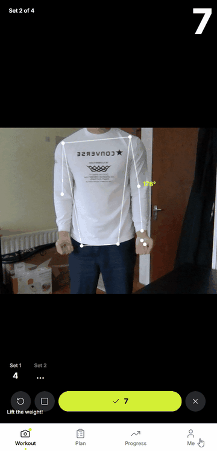
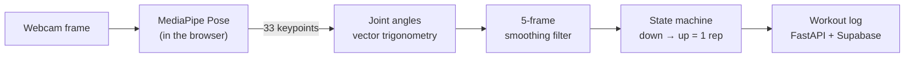

<div align="center">
  <h1>💪 GymPulse</h1>
  <p><strong>An AI fitness tracker that counts your reps through your webcam, in real time, without your video ever leaving your device.</strong></p>

  <a href="https://reactjs.org/"></a>
  <a href="https://fastapi.tiangolo.com/"></a>
  <a href="https://supabase.com/"></a>
  <a href="https://ai.google.dev/edge/mediapipe/solutions/vision/pose_landmarker"></a>

  <br /><br />
  
  <p><em>Real-time pose tracking counting bicep curl reps, then starting the rest timer.</em></p>
</div>

## Highlights

| | |
|---|---|
| **8 exercises** | squats, bicep curls, push-ups and more, counted automatically |
| **33 body keypoints** | tracked in 3D by Google MediaPipe Pose at **30+ FPS** |
| **100% in-browser AI** | the model runs in your browser (WebAssembly/WebGL): **no video is sent to any server** |
| **Progressive overload** | each workout is checked against its target and gets a PASS/FAIL and a next-step recommendation |

## What it does

- **Counts reps from your camera:** pick an exercise, start moving, and a skeleton overlay tracks your joints while reps are counted, with a rest timer between sets.
- **Plans your training:** create programs and weekly schedules with target weight, sets and reps.
- **Judges each session:** logged workouts are compared with their targets: *PASS → move to next week*, *FAIL → repeat the week*.
- **Shows progress:** charts of strength progression and completion rates over time.

## How the AI works



1. **Pose estimation, privately:** the MediaPipe Pose neural network runs entirely in the browser, so video never leaves the device.
2. **Kinematic math:** the app takes the joints that matter for each exercise (e.g. hip, knee and ankle for squats) and computes the angle between them with vector trigonometry.
3. **Signal processing:** a 5-frame moving average removes jitter, and a state machine (`down` → `up`) counts a rep only on a full movement.
4. **Progression engine:** the FastAPI backend compares each logged session with its schedule (weight, sets, reps) and recommends the next step.

## Tech stack

| Layer | Tools |
|---|---|
| AI / computer vision | Google MediaPipe Pose (WebGL / WebAssembly), HTML5 Canvas |
| Frontend | React, Vite, Chart.js, Axios |
| Backend | Python, FastAPI, Pydantic |
| Database | Supabase (PostgreSQL) |
| Hosting | Vercel (website), Render (API) |

<details>
<summary><b>Run it locally</b></summary>

**Backend** (from the project root):
```bash
python -m venv venv
source venv/Scripts/activate      # Windows (Git Bash); macOS/Linux: source venv/bin/activate
pip install -r requirements.txt
```
Create a `.env` file in the project root:
```env
SUPABASE_URL=your_supabase_url
SUPABASE_KEY=your_supabase_anon_key
```
Start the API (http://localhost:8000):
```bash
python backend/app/main.py
```

**Frontend** (new terminal):
```bash
cd frontend
npm install
npm run dev                       # http://localhost:5173
```

</details>

<details>
<summary><b>Run it with Docker</b></summary>

With the same `.env` file in the project root (`SUPABASE_URL`, `SUPABASE_KEY`):
```bash
docker compose up --build
```
- Web app: http://localhost:8080
- API: http://localhost:8000

The API image (`Dockerfile`) runs FastAPI with uvicorn as a non-root user. The web image (`frontend/Dockerfile`) builds the React app with Node, then serves the static files with nginx. CI builds and smoke-tests both images on every push.

</details>

<details>
<summary><b>Deploy (free tiers)</b></summary>

1. **API: Render.** Blueprints → New Blueprint Instance → this repo (uses `render.yaml`). Set `SUPABASE_URL`, `SUPABASE_KEY` and `ALLOWED_ORIGINS` (your Vercel URL).
2. **Website: Vercel.** Import the repo, root directory `frontend` (Vite is detected), and set `VITE_API_URL` to the Render URL.

The camera needs HTTPS, which Vercel provides.

</details>

## Project layout

```
backend/app/main.py     FastAPI: programs, schedules, workout logs, progression analysis
frontend/src/           React app: AICameraCounter.jsx (pose tracking + rep counting), dashboard, API client
render.yaml             Render blueprint for the API
```
