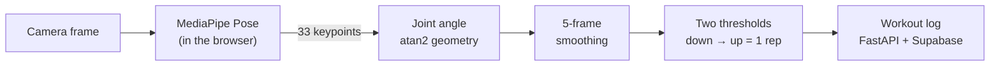

<div align="center">
  <h1>💪 GymPulse</h1>
  <p><strong>A workout tracker that counts your reps through your phone's camera, in real time, without your video ever leaving the device.</strong></p>

  <a href="https://github.com/ShaneFun/GymPulse/actions/workflows/ci.yml"></a>
  <a href="https://react.dev/"></a>
  <a href="https://fastapi.tiangolo.com/"></a>
  <a href="https://supabase.com/"></a>
  <a href="https://ai.google.dev/edge/mediapipe/solutions/vision/pose_landmarker"></a>

  <br /><br />
  
  <p><em>Real-time pose tracking counting bicep curl reps, then starting the rest timer.</em></p>
</div>

Set a plan (*3 sets of 10 bicep curls at 20 kg*) and GymPulse uses pose estimation to count each rep, calls the numbers out loud, times your rest, then grades the session against the target and offers to raise the weight next week if you passed.

## Highlights

| | |
|---|---|
| **8 exercises** | curls, squats, push-ups and more, counted automatically from the camera |
| **33 body keypoints** | tracked by Google MediaPipe Pose, entirely in the browser |
| **0 frames uploaded** | pose estimation runs on the device: **no video is sent to any server** |
| **Private accounts** | sign-in with Supabase Auth; row-level security scopes every row to its owner |
| **61 backend tests** | run by GitHub Actions on every push and pull request |

## Features

- **Camera rep counting** for eight exercises, using MediaPipe Pose and joint-angle geometry
- **Spoken cues** — every rep called out, a "last three" warning, and a tone on the target
- **Multi-exercise plans** with per-exercise targets, rest timers, and a longer break between exercises
- **Automatic progression** — pass a session and GymPulse offers next week's plan with your chosen weight and rep increments applied
- **Calendar view** of your history, colour-coded by personal best, pass, mixed or missed
- **Resumable sessions** — an interrupted workout survives a reload and offers to continue
- **Private by default** — row-level security scopes every row to its owner

## How the AI works



1. **Pose estimation, privately:** the MediaPipe Pose model runs in the browser (WebAssembly), so video never leaves the device.
2. **Joint angles:** three landmarks form the joint being measured (for a curl: shoulder, elbow, wrist) and two `atan2` calls give the angle between the limbs.
3. **Smoothing:** a five-frame rolling average removes the jitter inherent in pose estimation.
4. **Counting:** two thresholds, not one, decide a rep. The angle must pass the upper bound to arm and the lower to fire, which stops a paused arm from counting repeatedly.

Each exercise is five numbers (three landmark indices and two angles), so adding one means adding a config entry, not writing code.

## Tech stack

| Layer | Tools |
|---|---|
| AI / computer vision | Google MediaPipe Pose (WebAssembly), HTML5 Canvas |
| Frontend | React 19, Vite, Chart.js, lucide-react, supabase-js |
| Backend | Python, FastAPI, Pydantic, PyJWT |
| Database, auth & storage | Supabase: PostgreSQL with row-level security, Auth, Storage |
| Testing & CI | pytest (in-memory Supabase fake), ESLint, GitHub Actions |

## Getting started

### Prerequisites

- Python 3.11+
- Node.js 18+
- A Supabase project

### 1. Configure

```bash
cp .env.example .env
cp frontend/.env.example frontend/.env
```

Fill both with your Supabase project URL and **publishable** (anon) key, from
Dashboard → Settings → API. The backend reads `SUPABASE_URL` / `SUPABASE_KEY`;
the frontend reads `VITE_SUPABASE_URL` / `VITE_SUPABASE_ANON_KEY`.

> Use the publishable key, never the service role key — the latter bypasses
> row-level security and would expose every user's data.

### 2. Run the backend

```bash
python -m venv venv
source venv/Scripts/activate      # Windows
# source venv/bin/activate        # macOS / Linux

pip install -r requirements.txt
python backend/app/main.py
```

Serves on `http://127.0.0.1:8000`. There is no auto-reload — restart after
changing `main.py`.

### 3. Run the frontend

```bash
cd frontend
npm install
npm run dev
```

Serves on `http://localhost:5173` and proxies `/api` to the backend, so the
app works unchanged from another device on the network.

### 4. Create an account

Sign up on the login screen, or add a user from Dashboard → Authentication →
Users. Email confirmation is required by default.

## Using it from a phone

The camera needs a secure context, so plain HTTP over a local IP will not
work. [Tailscale](https://tailscale.com) is the simplest route:

```bash
tailscale serve --bg 5173
```

That publishes the dev server over HTTPS on your tailnet only.

## Tests

```bash
pytest -q                    # backend tests, no database required
cd frontend && npm run lint
cd frontend && npm run build
```

GitHub Actions (`.github/workflows/ci.yml`) runs all of this on every push to
`main` and every pull request.

Backend tests run against an in-memory fake of the Supabase client, so the
suite is fast and offline. The trade-off is that the fake has no schema and
cannot catch a mismatch with the real database.

## Project structure

```
backend/
  app/main.py          API — 11 endpoints
  tests/               pytest suite and the Supabase fake
frontend/src/
  App.jsx              application state and the session machine
  AICameraCounter.jsx  pose estimation and rep counting
  api/client.js        HTTP client and auth token injection
  auth/                sign in, sign up, password reset
  tabs/                Workout, Plan, Progress, Me
  lib/                 pure helpers — validation, calendar, audio
```

## Security

Every table has row-level security enabled, with policies scoping rows to
`auth.uid()`. The API carries the caller's JWT through to PostgREST, so the
database — not application code — is the thing enforcing access.

Policies do nothing while RLS is disabled on a table, and the two are set
separately. After any schema change, verify the switch itself:

```sql
select relname, relrowsecurity
from pg_class
where relname in ('programs','schedules','workout_logs','profiles','planned_days');
```
